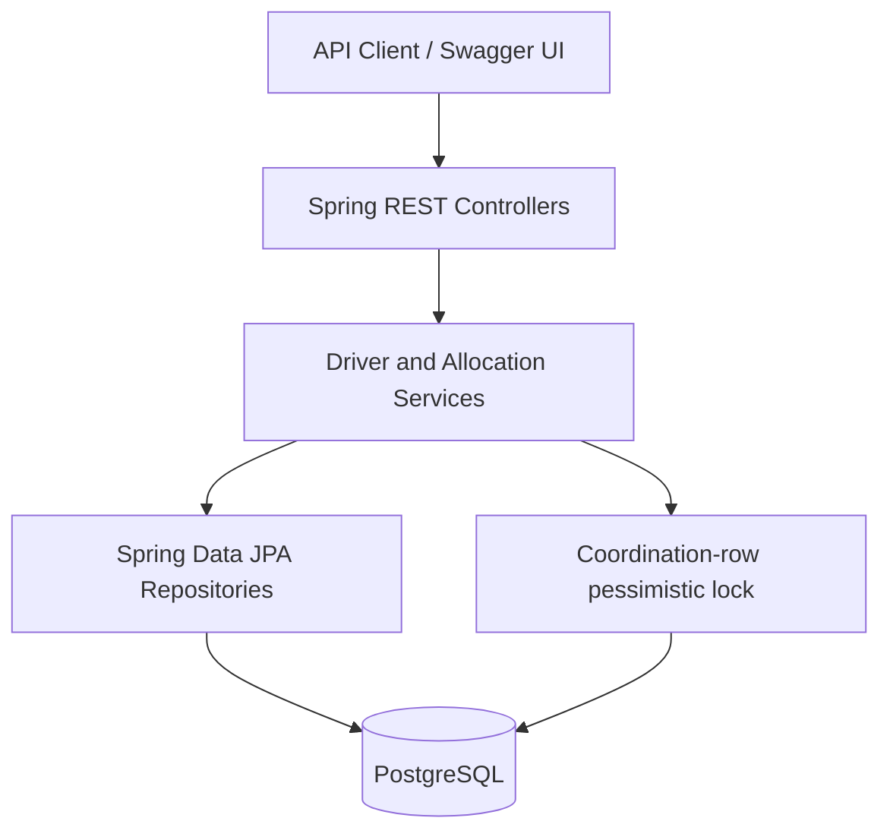

# LogiNext Driver Allocation System

A Java 17 and Spring Boot application for assigning incoming delivery orders to eligible drivers using deterministic scheduling rules. This repository is a case-study implementation focused on clear REST APIs, persistence, transaction safety, and explainable architectural decisions.

**Repository:** https://github.com/rits883/driver-allocation

## Features

- Register and retrieve drivers; activate or deactivate drivers.
- Allocate orders to the lowest-numbered **ACTIVE** driver available at the order's arrival time.
- Update driver availability after successful allocation.
- Reject allocation when no eligible driver is available.
- Apply chronological-order checks and order-reference idempotency in the persistent allocation workflow.
- Coordinate concurrent allocation and driver-status changes using a PostgreSQL row-level lock.
- Document HTTP APIs through Swagger UI / OpenAPI.

## Technology

| Component | Technology |
|---|---|
| Language | Java 17 |
| Framework | Spring Boot 4.1.2 |
| Persistence | Spring Data JPA / Hibernate |
| Database | PostgreSQL 17 |
| Schema migrations | Flyway |
| API documentation | SpringDoc OpenAPI |
| Build | Maven Wrapper |
| Boilerplate reduction | Lombok |

## Allocation rules

For each incoming order:

1. Check whether the order reference has already been processed, following the persistent workflow's idempotency policy.
2. Validate the order against the chronological processing constraint.
3. Consider only drivers with `status = ACTIVE` and `availableAt <= orderTime`.
4. Select the eligible driver with the lowest driver number / ordering key.
5. On success, update the driver's availability to `orderTime + travelTime` and persist the allocation.
6. If no driver qualifies, return the application's rejection outcome.

### Worked example from the case study

With two initially available drivers, process orders in the following sequence:

| Order | Order time | Travel time | Expected outcome |
|---|---:|---:|---|
| C1 | 1 | 10 | D1 |
| C2 | 4 | 20 | D2 |
| C3 | 15 | 5 | D1 |
| C4 | 22 | 20 | D1 |
| C5 | 24 | 10 | D2 |
| C6 | 25 | 10 | No Food :-( |

This table illustrates the **allocation algorithm**, not a claim about the exact JSON schema of the REST endpoint.

## Architecture



The application uses a layered architecture. The persistent allocation service performs its work inside a database transaction and locks a singleton coordination row to serialize conflicting allocation decisions across application instances. This favors correctness and simple reasoning over maximum allocation throughput.

**Trade-off:** A single coordination row can become a bottleneck at high request volumes. More granular partitioning would require a careful redesign of ordering and consistency rules.

## Prerequisites

- JDK 17
- Docker (recommended for local PostgreSQL) **or** an existing PostgreSQL 17 instance
- Git
- An available local port `8085`

The repository includes the Maven Wrapper, so a separate Maven installation is not required.

## Run locally

### 1. Clone the repository

```bash
 git clone https://github.com/rits883/driver-allocation.git
 cd driver-allocation
```

### 2. Start PostgreSQL

The following example starts a local PostgreSQL instance on host port `5434`:

```bash
docker run --name driver-allocation-postgres \
  -e POSTGRES_DB=driver_allocation \
  -e POSTGRES_USER=postgres \
  -e POSTGRES_PASSWORD=local_dev_password \
  -p 5434:5432 \
  -d postgres:17-alpine
```

If you already have a PostgreSQL instance running, create the `driver_allocation` database there and use its actual host, port, username and password. Do not start a second container on an occupied port.

### 3. Configure the datasource

Set the datasource configuration to match your local environment. For example, a Spring Boot configuration using environment variables can look like:

```yaml
spring:
  datasource:
    url: ${DB_URL:jdbc:postgresql://localhost:5434/driver_allocation}
    username: ${DB_USERNAME:postgres}
    password: ${DB_PASSWORD}
server:
  port: 8085
```

**Important:** This is a configuration example, not a verified copy of the repository's current `application.properties` / `application.yml`. Check the actual file and use its configured property names. Never commit real credentials.

For the example container, set:

```bash
export DB_URL='jdbc:postgresql://localhost:5434/driver_allocation'
export DB_USERNAME='postgres'
export DB_PASSWORD='local_dev_password'
```

### 4. Build and run

```bash
chmod +x mvnw
./mvnw clean package -DskipTests
./mvnw spring-boot:run
```

On startup, Flyway should apply the repository's database migrations if enabled in the application configuration. Verify successful startup in the logs.

### 5. Open Swagger

- Swagger UI: http://localhost:8085/swagger-ui/index.html
- OpenAPI specification: http://localhost:8085/v3/api-docs

These URLs work when the application is running locally on port `8085`; they are **not** a publicly hosted test environment.

## Driver management API

| Method | Path | Purpose |
|---|---|---|
| `POST` | `/api/v1/drivers` | Register a driver |
| `GET` | `/api/v1/drivers` | List drivers (paginated) |
| `GET` | `/api/v1/drivers/{id}` | Get driver by ID |
| `PATCH` | `/api/v1/drivers/{id}/status` | Activate or deactivate a driver |

### Register a driver

```bash
curl -i -X POST 'http://localhost:8085/api/v1/drivers' \
  -H 'Content-Type: application/json' \
  -d '{"driverCode":"DRIVER-101"}'
```

Illustrative success response (`id` is generated by the database):

```json
{
  "id": 1,
  "driverCode": "DRIVER-101",
  "status": "ACTIVE",
  "availableAt": 0
}
```

### List drivers

```bash
curl -i 'http://localhost:8085/api/v1/drivers?page=0&size=10'
```

For sorting, follow the parameters currently exposed by Swagger. Depending on the controller version, these may be Spring Data's `sort=id,asc` or explicit `sortBy=id&direction=asc` parameters.

### Retrieve a driver

```bash
curl -i 'http://localhost:8085/api/v1/drivers/1'
```

### Deactivate a driver

```bash
curl -i -X PATCH 'http://localhost:8085/api/v1/drivers/1/status' \
  -H 'Content-Type: application/json' \
  -d '{"status":"INACTIVE"}'
```

Reactivate using `{"status":"ACTIVE"}`. Changing status affects **future** allocation eligibility; it does not retroactively cancel an existing assignment.

## Order allocation — primary evaluation workflow

**This is the core functionality to evaluate.** Open Swagger UI, locate the allocation controller, and use its generated request schema to submit an order or simulation request.

The published API reference currently identifies `AllocationController.simulate(AllocationRequest)` but does **not** confirm the exact HTTP path or request/response fields. Rather than publish an incorrect curl example, use the live Swagger definition until those source details are verified and documented.

### Manual evaluation scenarios

| Scenario | Expected behavior |
|---|---|
| Two eligible ACTIVE drivers | Select the lowest-numbered driver |
| Lowest-numbered driver busy | Select the next eligible driver |
| All drivers busy or inactive | Return rejection outcome |
| Driver assigned successfully | Update its `availableAt` to `orderTime + travelTime` |
| Duplicate order reference | Do not create a second allocation |
| Earlier order time | Enforce chronological processing rule |
| Concurrent allocations | Avoid conflicting assignments through transactional coordination |

For reproducible results, use a fresh database or a known initial driver state before running the full six-order example. Existing orders and availability values can change the outcome.

## Order retrieval

An order-listing API (`GET /api/v1/orders`) and an order-detail API (`GET /api/v1/orders/{id}`) have been designed during development. **Confirm that these endpoints exist in the current checked-in code and appear in Swagger before treating them as implemented.**

If available, the listing API can be used to inspect stored orders and allocation outcomes. Otherwise, inspect the database tables directly.

## Database inspection

Using a PostgreSQL client such as DBeaver or `psql`:

```sql
SELECT * FROM drivers ORDER BY id;
SELECT * FROM orders ORDER BY id;
SELECT * FROM driver_allocations ORDER BY id;
SELECT * FROM allocation_coordination;
```

The main persisted tables cover drivers, orders, allocations and the coordination row. Flyway migration scripts in `src/main/resources/db/migration/` are the source of truth for the database schema.

## API errors

The application uses standardized API error responses based on Spring's `ProblemDetail`, including an application-specific `errorCode` where configured. Typical cases include validation failures (`400`), unknown driver (`404`), duplicate registration (`409`), and unexpected server errors (`500`). The exact allocation rejection HTTP status is defined by the implementation.

## Design documentation

- [High-Level Design](docs/HLD.md)
- [Low-Level Design](docs/LLD.md)
- [API reference](docs/API.md)

The documents describe the architecture, allocation algorithm, database coordination, API contracts, and implementation trade-offs.

## Scope and design decisions

This is a focused coding-challenge implementation, not a complete logistics platform. Live GPS tracking, route optimization, external dispatch integrations, messaging infrastructure, and distributed rate limiting are outside its current scope.

The core concurrency mechanism is PostgreSQL transaction coordination. Circuit breakers and automatic retries are intentionally not required for the local database-backed allocation workflow.

## Submission checklist

- [ ] Confirm the application builds and starts on a clean machine.
- [ ] Confirm database credentials are not committed.
- [ ] Verify all documented routes against the current Swagger specification.
- [ ] Replace the allocation API documentation's unverified placeholders with the actual endpoint and DTO examples.
- [ ] Verify the six-order example against a clean driver state.
- [ ] Confirm that order-listing endpoints are implemented before advertising them as available.

---

**Case study:** LogiNext Driver Allocation System  
**Repository:** https://github.com/rits883/driver-allocation
