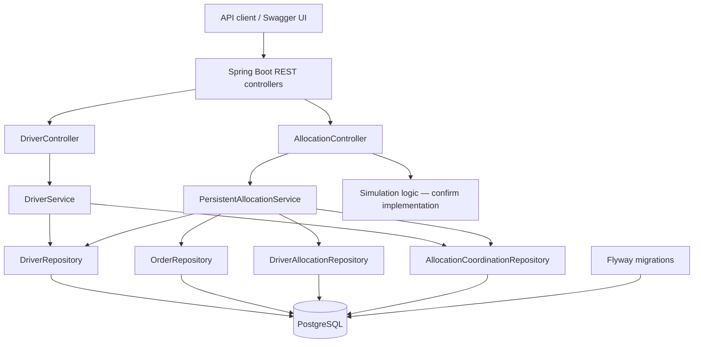
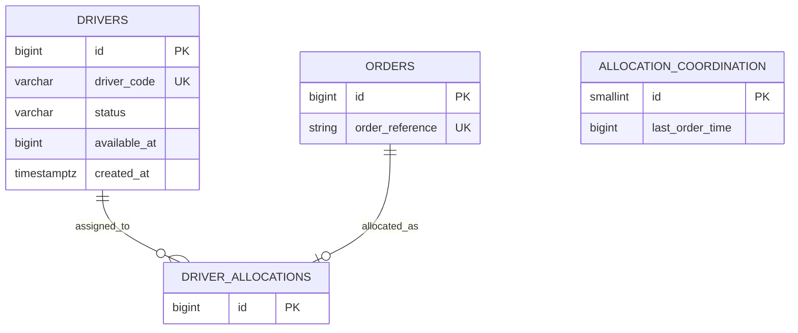
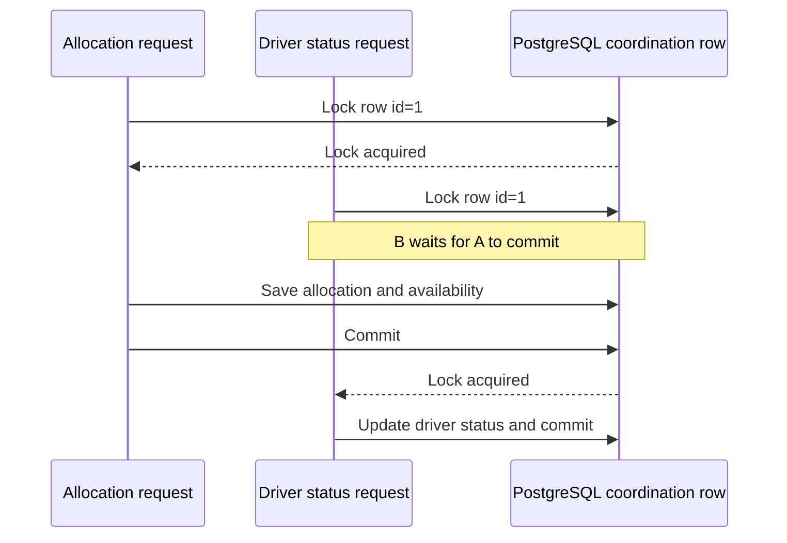

# LogiNext Driver Allocation — High-Level Design (HLD)

**Version:** 1.0  
**Stack:** Java 17, Spring Boot 4.1.2, Spring Data JPA, PostgreSQL 17, Flyway, Lombok, SpringDoc OpenAPI  
**Status:** Architecture documentation based on the implementation discussed; confirm against the final repository before submission.

## 1. Purpose and scope

The  a food-delivery dispatch algorithm: for each order at time `O` with travel duration `T`, allocate the **lowest-index available driver**; if every driver is busy, return **`No Food :-(`**. A driver serves one order at a time and becomes available again at `O + T`. The original example uses six orders and two drivers.

Our implementation extends  with REST APIs, persisted driver/order/allocation state, driver activation/deactivation, idempotent order references, chronological processing, OpenAPI documentation, and concurrency coordination. **These extensions are implementation choices, not requirements explicitly stated by the challenge.**

## 2. Architecture overview



This is a **modular monolith**: one deployable application with clear controller, service, persistence, and domain boundaries. No distributed message broker or microservice split is required for the challenge.

## 3. Responsibilities

| Component | Responsibility |
|---|---|
| `DriverController` | Driver registration, retrieval, pagination, status updates |
| `AllocationController` | Allocation and simulation HTTP entry points; verify actual route names |
| `DriverService` | Driver creation, queries, activation/deactivation |
| `PersistentAllocationService` | Transactional allocation, chronology and idempotency rules |
| Spring Data repositories | Entity persistence and locking queries |
| PostgreSQL | Durable data and transactional consistency |
| Flyway | Versioned schema changes |
| SpringDoc | OpenAPI generation and Swagger UI |
| Global exception handler | Consistent HTTP problem responses |

## 4. Data model



**Schema caveat:** The driver fields above are confirmed from the shared `DriverEntity`. The order/allocation columns and foreign-key names must be copied from the actual Flyway migrations before publishing a precise physical ERD. The `allocation_coordination` singleton (`id = 1`) and `last_order_time` come from our agreed design.

### Driver availability

`available_at` stores a **logical time**, not a timestamp. For an order with `orderTime = 15`, a driver is eligible when `availableAt <= 15`, provided their status is `ACTIVE`. A successful allocation updates availability to `orderTime + travelTime`.

## 5. Allocation consistency and concurrency

The persistent allocation service runs in a database transaction and first locks the singleton coordination row using `SELECT ... FOR UPDATE` through `findByIdForUpdate((short) 1)`.



Both allocation and status-changing services **must acquire the same lock before reading/updating driver state**. This gives a deterministic database ordering across app instances, at the cost of serializing writes through a single row.

**Isolation:** PostgreSQL `READ COMMITTED` is acceptable with this shared serialization discipline. The lock does not protect code paths that bypass it.

## 6. API surface

| Domain | Operations |
|---|---|
| Drivers | Register, list with pagination, get by ID, activate/deactivate |
| Allocation | Persistently allocate an order; simulation endpoint is present but exact contract needs source confirmation |
| Operations | Swagger UI and Actuator endpoints (availability depends on configuration) |

See [API.md](API.md) for confirmed driver routes and allocation route verification items.

## 7. Non-functional considerations

- **Correctness:** Lowest-index eligible driver; a driver cannot overlap assignments.
- **Consistency:** One shared database lock orders allocation and status updates.
- **Idempotency:** Duplicate order references should return the established outcome rather than allocate twice; exact behavior on changed duplicate payloads needs confirmation.
- **Validation:** Reject malformed requests, negative times/durations, and invalid status values as defined by DTO validation.
- **Observability:** Structured error logging; do not expose internal stack traces in HTTP responses.
- **API stability:** Return `PagedModel` or a custom pagination DTO, not raw `PageImpl` JSON.
- **Scalability:** Reads may scale independently, but allocation throughput is bounded by singleton-lock contention.
- **Security:** Swagger and Actuator endpoints should be restricted or disabled in a production deployment; authentication/authorization are not established features of this challenge implementation.

## 8. Design trade-offs

| Choice | Benefit | Cost |
|---|---|---|
| Modular monolith | Simple build, deployment, transaction scope | Coarse-grained deployment |
| PostgreSQL row lock | Cross-instance correctness without distributed locks | Serializes allocation/status writes |
| Relational persistence | Auditable orders and allocations | Database required to run |
| Java records for DTOs | Compact, immutable API contracts | Not suitable for mutable JPA entities |
| Lombok on entities/services | Less boilerplate | Annotation processor dependency |

## 9. Original challenge example

Input: `N=6`, `M=2`, orders `(1,10), (4,20), (15,5), (22,20), (24,10), (25,10)`.

Expected output:

```text
C1 - D1
C2 - D2
C3 - D1
C4 - D1
C5 - D2
C6 - No Food :-(
```

The challenge uses one-based driver indexes (`D1`, `D2`). Ensure the persistent selection rule maps these indexes consistently to driver identity or ordering; an arbitrary database ID is not automatically the same as the challenge's driver index.

## 10. Review before submission

Confirm final Flyway column definitions, allocation controller paths, simulation side effects, exact error mappings, driver selection ordering, and the complete sample output against the runnable code.
