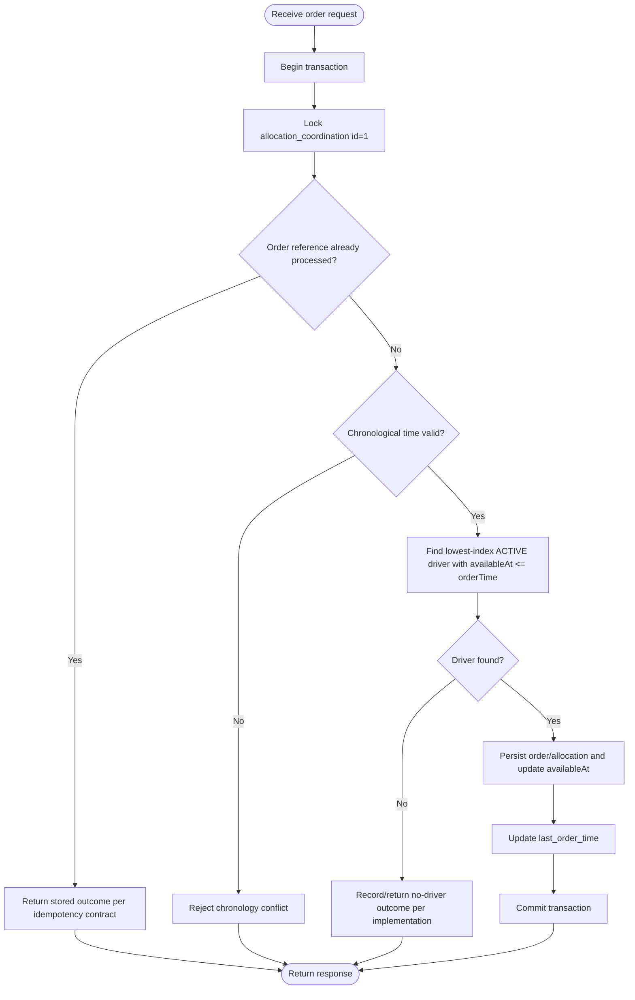
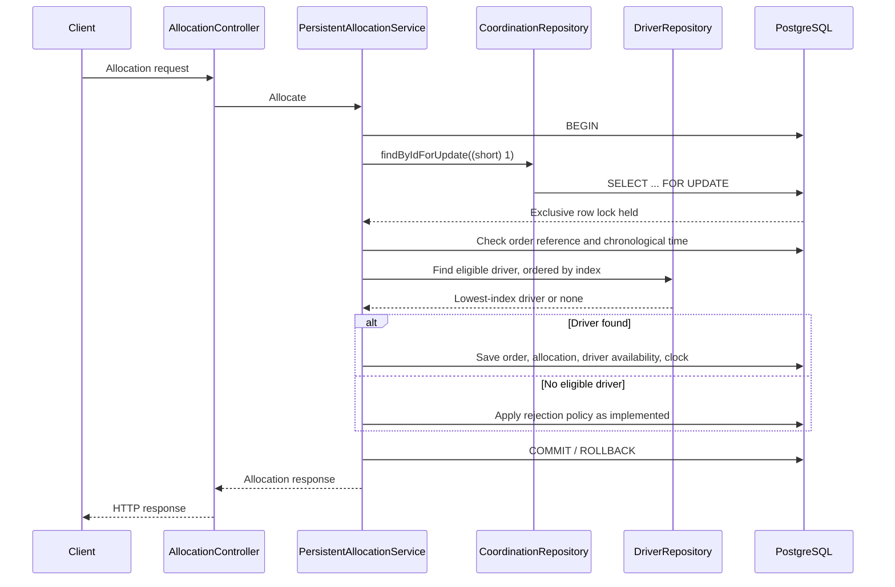

# LogiNext Driver Allocation — Low-Level Design (LLD)

**Version:** 1.0  
**Purpose:** Document business rules, classes, data flow, persistence, and concurrent behavior. Code signatures below reflect the discussed design and may need adjustment to the final source tree.

## 1. Core algorithm

For each customer order `(O, T)` in chronological order:

1. Identify drivers whose status is `ACTIVE` and `availableAt <= O`.
2. Select the **lowest-index** eligible driver.
3. If none exists, report `No Food :-(`.
4. Otherwise allocate that driver and set `availableAt = O + T`.

The driver's **BUSY** state in the original challenge is a time-dependent condition: `availableAt > O`. In the extended system, `ACTIVE`/`INACTIVE` represents an administrative status and is **not the same** as busy/free.

### Pseudocode

```text
for each order (O, T) in chronological order:
    eligible = active drivers with availableAt <= O
    driver = eligible driver with smallest driver index
    if driver is absent:
        emit "No Food :-("
    else:
        emit customer -> driver
        driver.availableAt = O + T
```

For an in-memory list of `M` drivers, scanning each of `N` orders costs **O(N × M)** time and **O(M)** driver-state space (excluding output). A priority-queue design may improve performance, but must preserve the *lowest-index among currently available* rule.

## 2. Persistent allocation flow



**Implementation-specific checks:** Confirm whether rejected orders are persisted, whether the coordination clock advances for rejected orders, and whether duplicate rejected orders return stored results. These decisions affect retries and must match the actual code.

## 3. Class responsibilities

### `DriverEntity`

Known fields from the shared entity:

```java
Long id;
String driverCode;       // unique, max 50 characters
String status;           // ACTIVE or INACTIVE
Long availableAt;        // logical time, default 0
OffsetDateTime createdAt; // database-managed
```

Domain operations:

```java
new DriverEntity(driverCode);
driver.updateAvailability(newTime);
driver.activate();
driver.deactivate();
driver.isActive();
```

Do not reintroduce public setters for protected business state. JPA requires a no-argument constructor, which may be `protected`.

### `DriverService`

```java
DriverResponse register(CreateDriverRequest request);
Page<DriverResponse> getAllDrivers(Pageable pageable);
DriverResponse getDriverById(Long id);
DriverResponse updateDriverStatus(Long id, DriverStatusRequest request);
```

- Registration trims and validates the driver code.
- Listing maps entities into response records; controller wraps the page as `PagedModel`.
- Missing IDs map to `404`.
- Status updates acquire the same coordination row lock used by allocation, then update the managed entity within a transaction.

### `PersistentAllocationService`

Expected responsibilities:

- Lock coordination row at transaction start.
- Resolve order-reference idempotency.
- Enforce chronological ordering.
- Query available active drivers in ascending driver-index order.
- Persist successful allocation and update driver availability.
- Return the existing allocation response contract.

**Do not assume method names or response fields beyond what is visible in the actual source.**

### Repositories

- `DriverRepository extends JpaRepository<DriverEntity, Long>` provides `findAll(Pageable)`, `findById`, and `existsByDriverCode`.
- `AllocationCoordinationRepository` exposes a pessimistic locking query `findByIdForUpdate(Short)`.
- Order/allocation repositories persist and look up allocation records; inspect their current interfaces for precise signatures.

## 4. Transaction boundaries and lock ordering

### Allocate order



### Change driver status

```text
@Transactional
  acquire coordination row lock (Short ID = 1)
  load driver by ID
  activate() or deactivate()
  flush/commit managed entity change
```

Always lock coordination **before** querying or changing allocation-sensitive driver state to reduce race conditions and deadlock risk. A status change does not cancel an already-created allocation.

## 5. Input validation

| Input | Expected validation |
|---|---|
| Driver code | Nonblank, trimmed, <= 50 characters, unique |
| Driver status | Enum `ACTIVE` or `INACTIVE`, non-null |
| Driver ID | Must identify an existing driver |
| Order time | Nonnegative and chronologically valid (verify exact policy) |
| Travel time | Nonnegative or positive as required by actual DTO (verify) |
| Order reference | Nonblank/unique for idempotency (verify actual DTO constraints) |
| Pagination | Page >= 0, bounded size, permitted sort fields |

For availability arithmetic, consider `Math.addExact(orderTime, travelTime)` to avoid silent `long` overflow if not already handled.

## 6. Error handling

The discussed API error format uses Spring `ProblemDetail`:

```json
{
  "type": "about:blank",
  "title": "Not Found",
  "status": 404,
  "detail": "Driver not found with ID: 99",
  "instance": "/api/v1/drivers/99",
  "errorCode": "DRIVER_NOT_FOUND"
}
```

The handler should map validation and malformed JSON to `400`, missing resources to `404`, business conflicts to `409`, and unexpected failures to `500` without exposing internal details. Database uniqueness violations need targeted handling; catching all integrity violations as duplicate-driver errors is unsafe.

## 7. Worked example: original challenge

| Customer | Order time | Travel time | Chosen driver | Driver available next |
|---|---:|---:|---|---:|
| C1 | 1 | 10 | D1 | 11 |
| C2 | 4 | 20 | D2 | 24 |
| C3 | 15 | 5 | D1 | 20 |
| C4 | 22 | 20 | D1 | 42 |
| C5 | 24 | 10 | D2 | 34 |
| C6 | 25 | 10 | No Food :-( | — |

At time 25, D1 is busy until 42 and D2 until 34, so C6 cannot be served.

## 8. Manual verification matrix (no automated tests)

| Scenario | Expected behavior |
|---|---|
| Register new driver | HTTP 201, ACTIVE, availableAt=0 |
| Register duplicate driverCode | HTTP 409 if correctly mapped |
| List drivers | Stable paginated JSON |
| Get unknown driver | HTTP 404 |
| Deactivate driver | Driver excluded from future allocations |
| Reactivate driver | Driver eligible again when availableAt <= orderTime |
| Two simultaneous allocations | No overlapping assignment; serialized through coordination row |
| Repeat order reference | Same persisted outcome; no duplicate allocation |
| Out-of-order request | Rejected per chronology rule |
| All drivers busy | `No Food :-(` business outcome |
| Original six-order example | D1, D2, D1, D1, D2, No Food :-( |

## 9. Implementation checklist

- [ ] Verify actual Flyway table/column definitions.
- [ ] Verify lowest-index ordering does not accidentally use arbitrary database ID order.
- [ ] Verify rejected-order persistence and chronology-clock policy.
- [ ] Verify duplicate requests with different payloads.
- [ ] Verify shared lock used by both allocation and driver status updates.
- [ ] Verify final API status codes against running endpoints.
